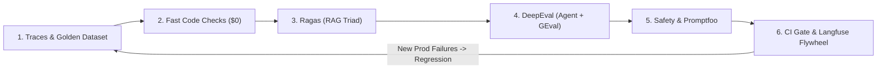

# AI System & Agent Evaluation Engineering — Hands-On Lab (English & Sinhala)

A clean, production-aligned **End-to-End AI Evaluation Engineering** repository demonstrating how industry teams test, diagnose, red-team, gate, and monitor **RAG Pipelines** and **Tool-Calling AI Agents** using **Ragas**, **DeepEval**, **Promptfoo**, and **Langfuse**.

Built around one shared demo application (**LankaShop Customer Support & Refund AI Agent** in [`lankashop.py`](./lankashop.py)), the curriculum is split into **5 focused, readable notebooks** available in both **English** and **Sinhala** — and runs completely free out of the box in **`$0` Offline Mock Mode** or against live OpenAI models via `.env`.

---

## What Has Been Built

- **Shared Stateful Demo Agent ([`lankashop.py`](./lankashop.py)):**
  - Policy retrieval (`DOC-RETURN`, `DOC-SHIPPING`), stateful order database (`ORDERS_DB`), tool execution (`get_order`, `issue_refund`), and built-in `bug_mode` / `retriever_bug` toggles (`bad_json`, `hallucination`, `bad_tool`, `rude_tone`, `vulnerable`) so every evaluation metric visibly catches real bugs.
  - Safe `.env` loader + Jupyter-compatible `run_async` helper + clean `$0` offline mocks alongside optional live OpenAI execution (`USE_LIVE_API = True`).
- **Two Complete Bilingual Tracks:**
  - **English Track ([`english/`](./english/README.md)):** End-to-End Theory Guide + 5 progressive hands-on Jupyter notebooks.
  - **Sinhala Track ([`sinhala/`](./sinhala/README.md)):** Full Sinhala End-to-End Theory Guide (`සිංහලෙන්`) + 5 progressive hands-on Jupyter notebooks.
- **Real Industry Tooling Integration (`Python 3.13`):**
  - **Ragas (`0.4.3`):** Separates retrieval misses (`Context Recall`, `Context Precision`) from generation hallucinations (`Faithfulness`).
  - **DeepEval (`4.3.3`):** Verifies agent tool trajectories (`ToolCorrectnessMetric`) + backend database mutations, runs custom binary LLM Judges (`GEval`) calibrated against human labels (`>= 85%` agreement), and models `pass@k` vs `pass^k` reliability.
  - **Promptfoo:** Generates A/B prompt testing & adversarial red-team matrices (`promptfooconfig.yaml`) while balancing `ASR` vs `FRR`.
  - **Langfuse (`5.2.0`):** Connects Layer 1 pre-merge CI/CD release gates to Layer 2 observability traces, online scores, and the continuous **Eval Flywheel** (`golden_dataset.json` regression growth).

---

## End-to-End Evaluation Architecture

---

## Repository Structure

| Path | Description |
| :--- | :--- |
| [`README.md`](./README.md) | Main repository overview (this file) |
| [`lankashop.py`](./lankashop.py) | Shared LankaShop RAG + Refund Agent, demo DB, bug switches, and live/mock LLM helper |
| [`english/`](./english/README.md) | **English Learning Track** — Theory Guide + 5 hands-on notebooks |
| [`sinhala/`](./sinhala/README.md) | **Sinhala Learning Track (`සිංහල`)** — Theory Guide + 5 hands-on notebooks |
| [`.gitignore`](./.gitignore) | Ignores `.venv/`, `.env`, caches, and local eval outputs |

---

## 5-Part Hands-On Notebook Roadmap

| # | Topic & Framework | Key Concepts Covered | English | Sinhala |
| :-: | :--- | :--- | :--- | :--- |
| **01** | **Traces, Golden Dataset & Fast Checks** | Open Coding, Existing Traces vs Synthetic Cases, `golden_dataset.json`, `$0` JSON/PII checks | [Open](./english/01_traces_golden_dataset_and_code_checks.ipynb) | [Open](./sinhala/01_traces_golden_dataset_and_code_checks.ipynb) |
| **02** | **RAG Diagnostics (`Ragas`)** | `Context Recall`, `Context Precision`, `Faithfulness` (Retrieval Miss vs Hallucination) | [Open](./english/02_rag_evaluation_with_ragas.ipynb) | [Open](./sinhala/02_rag_evaluation_with_ragas.ipynb) |
| **03** | **Agents & LLM Judge (`DeepEval`)** | `ToolCorrectnessMetric`, Backend DB State, `GEval` + Human Calibration, `pass@k` vs `pass^k` | [Open](./english/03_agent_tools_and_llm_judge_deepeval.ipynb) | [Open](./sinhala/03_agent_tools_and_llm_judge_deepeval.ipynb) |
| **04** | **Safety & Red Teaming (`Promptfoo`)** | Prompt Injection, PII Leaks, `ASR` (`0%`) vs `FRR` (`~0%`), `promptfooconfig.yaml` | [Open](./english/04_safety_red_teaming_and_promptfoo.ipynb) | [Open](./sinhala/04_safety_red_teaming_and_promptfoo.ipynb) |
| **05** | **CI Gate, `Langfuse` & Flywheel** | Layer 1 Release Gate Scorecard, Layer 2 Traces & Online Scores, Regression Flywheel | [Open](./english/05_ci_gate_langfuse_and_flywheel.ipynb) | [Open](./sinhala/05_ci_gate_langfuse_and_flywheel.ipynb) |

---

## Quickstart

### 1. Select the Kernel
Open any notebook from [`english/`](./english/README.md) or [`sinhala/`](./sinhala/README.md) in VS Code / Jupyter and select the **`Python (.venv AI Eval)`** kernel.

> **Environment Packages Verified:** `ragas==0.4.3`, `deepeval==4.3.3`, `langfuse==5.2.0`, `openai==3.3.0`, `langchain-community==0.3.31`, `rapidfuzz==3.14.6`, `pandas`, `pyyaml`, `python-dotenv`, `pydantic`.

### 2. Choose `$0` Offline Mock Mode or Live OpenAI Mode
- **Default (`$0` Offline Mock Mode):** Every notebook starts with `USE_LIVE_API = False`, letting you test all evaluation logic, Ragas/DeepEval metrics, and failure diagnoses at zero API cost.
- **Live API Mode:** Add your `OPENAI_API_KEY` to `.env` in the repo root and toggle `USE_LIVE_API = True` in Cell 1 of any notebook.
- **Optional Live Langfuse & Promptfoo CLI:**
  - Add `LANGFUSE_PUBLIC_KEY` and `LANGFUSE_SECRET_KEY` to `.env` before running Notebook `05` to upload live traces.
  - Inside `english/` or `sinhala/` after running Notebook `04`, run `npx promptfoo@latest eval` (with Node.js) to execute `promptfooconfig.yaml`.

