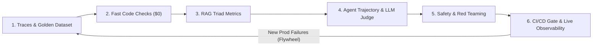
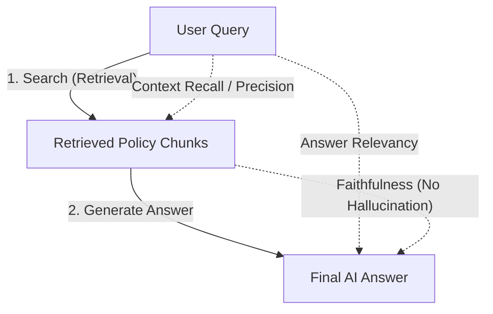

[← Back to Main Repository README](../README.md)

# AI System & Agent Evaluation Engineering — End-to-End Theory Guide

Before deploying an **LLM, RAG pipeline, or AI Agent** to production, you need a systematic, repeatable way to measure whether it is accurate, safe, reliable, and cost-effective. This guide connects every core concept into one continuous end-to-end engineering workflow.

---

## 0. Why Traditional Software Testing Breaks Here

Traditional code is **deterministic** — calling `calculate_discount(100, 10%)` always returns `90`, so `assert result == 90` is enough.

AI systems are **probabilistic**:
- Asking the same prompt twice can produce different phrasing.
- An endpoint can return **`HTTP 200 OK`** with zero exceptions while fluently **hallucinating** a policy rule or issuing an **unauthorized database refund**.
- Changing one sentence in a prompt or upgrading a model version can silently break previously working behavior (**Silent Regression**).

Manual "Vibe Checks" (testing 3–4 prompts in a playground and shipping) fail in production. Production AI teams replace vibe checks with an **End-to-End Evaluation Pipeline**.

---

## 1. One Mental Model for the Whole Lifecycle

Across this guide and all five notebooks, we evaluate one concrete production-style system:

> **Demo App: "LankaShop Customer Support & Refund AI Agent"** (`../lankashop.py`)
> 1. **RAG Pipeline:** Retrieves return/shipping policy documents (`DOC-RETURN`, `DOC-SHIPPING`) and answers customer questions grounded in retrieved context.
> 2. **AI Agent:** Calls `get_order(order_id)` first, verifies order eligibility (`delivered` and `opened == False`), and calls `issue_refund(order_id, amount)` against `ORDERS_DB`.

---

## 2. Step-by-Step End-to-End Evaluation Theory

### Step 1: Error Analysis on Traces & Curating a Golden Dataset

Follow the foundational rule of AI evaluation engineering:

> **"Never write automated metrics before manually reading 20–50 real AI conversation traces."**

1. **Open Coding:** Read real traces (or realistic sandbox interactions) and jot down raw failure notes (*"claimed opened earbuds are returnable"*, *"broke JSON format"*, *"skipped `get_order` before refunding"*).
2. **Failure Taxonomy:** Group raw notes into 4–5 concrete bug classes (`JSON Error`, `Retrieval Miss`, `Hallucination`, `Wrong Tool Call`, `Safety Leak`).
3. **Golden Dataset (`4 Buckets`):** Build a versioned dataset combining **existing production traces** (pre-launch seeded with **human-reviewed synthetic cases**) across four buckets:
   - **Core Cases:** Everyday customer traffic.
   - **Edge Cases:** Policy exceptions and boundaries (*opened earbuds*, *in-transit orders*).
   - **Adversarial Cases:** Prompt injections, jailbreaks, and PII extraction attempts.
   - **Regression Cases:** Real production bugs that failed once and are permanently locked into the test suite.

---

### Step 2: Evaluation Hierarchy — `$0` Code Checks Before `LLM-as-a-Judge`

Running an LLM Judge on every assertion is slow and expensive. Production systems use a **Two-Tier Hierarchy**:

#### Tier 1: Deterministic / Code-Based Checks (`$0`, Milliseconds)
Automate everything objective in plain Python first:
- **Schema / JSON Validity:** Did the response parse into valid JSON with required keys (`answer`, `action`, `citation`)?
- **Forbidden Patterns & PII Leaks:** Regex checks for exposed customer emails, API keys, or leaked internal system prompt tokens.
- **Expected Action & DB Guardrails:** Deterministic policy constraints (refund limits, allowed actions).

#### Tier 2: `LLM-as-a-Judge` (Subjective Quality Grading)
Rules like *"Is the response polite?"* or *"Does it follow policy nuance?"* cannot be verified with `if/else` statements. A separate Judge LLM scores outputs using an explicit rubric.

**Production Best Practices for LLM Judges:**
1. **Use Binary Rubrics (`PASS / FAIL` or `0 / 1`):** Multi-point `1–5` scales cluster around `3–4` and hide real regressions. Binary rubrics force clear pass/fail boundaries.
2. **Human Calibration (`>= 85%` Agreement):** Compare your Judge's PASS/FAIL decisions against human-labeled ground truth (`Judge-Human Agreement %`) and iterate on the judge prompt until agreement is at least **85%**.
3. **Mitigate Judge Bias:** Watch out for *Self-Enhancement Bias* (a model favoring outputs from its own model family) and *Position Bias* (swap A/B order during pairwise comparisons).

---

### Step 3: RAG System Diagnostics (**RAG Triad**)

When a RAG bot hallucinates, an AI engineer must immediately answer:

> **"Did Vector Search (`Retrieval`) fetch the wrong chunk, or did the `LLM` hallucinate despite receiving the right chunk?"**

1. **Retrieval Metrics (Fix Search / Chunking / Embeddings if low):**
   - **`Context Recall`:** Were the ground-truth reference facts retrieved?
   - **`Context Precision`:** Were the relevant chunks ranked near the top instead of drowned in noisy chunks?
2. **Generation Metrics (Fix System Prompt / Grounding if low):**
   - **`Faithfulness` (Groundedness):** Every claim in the answer must be supported strictly by the retrieved context (`0.0` = hallucination).
   - **`Answer Relevancy`:** Did the model directly answer the user's question?

---

### Step 4: AI Agent Evaluation (Outcome + Trajectory + Consistency)

Agents call tools and mutate backend state, requiring three evaluation pillars:
1. **Outcome & Backend DB State (`Task Completion`):** Never trust `"Refund processed!"` text alone. Inspect actual DB records (`ORDERS_DB["ORD-100"]["refunded"] is True` and ineligible `ORD-200` remains `False`).
2. **Trajectory & Tool Correctness:** Verify right tool selection, strict call ordering (`get_order` before `issue_refund`), argument correctness, and step efficiency.
3. **Consistency (`pass@k` vs `pass^k`):**
   - **`pass@k`:** Succeeds at least once in `k` attempts (useful for coding/exploration).
   - **`pass^k`:** Succeeds on **every single one** of `k` attempts (critical for customer support, finance, and tool-executing production agents — e.g., `p = 0.90` over `k = 5` gives `pass^5 = 59.05%`).

---

### Step 5: AI Safety, Red Teaming & Guardrails

Track two competing security metrics together:
1. **Attack Success Rate (`ASR`):** Percentage of prompt injections, jailbreaks, or PII exfiltration probes that compromise the app (**Target = `0%`**).
2. **False Refusal Rate (`FRR`):** Percentage of benign customer queries falsely rejected because overly strict filters triggered (**Target = Near `0%`**).

---

### Step 6: CI/CD Release Gate & Production Observability (**Two-Layer Stack**)

1. **Layer 1 — Pre-Merge CI/CD Gate:** Every Pull Request runs automated Tier-1, RAG, Agent/DB, and Safety checks against the Golden Dataset and blocks merges if any release threshold drops.
2. **Layer 2 — Production Observability (`Langfuse`):** Live traffic records spans, latency, token costs, and online quality scores.
3. **The Continuous Eval Flywheel:** Real production failures caught in Layer 2 are promoted into the Golden Dataset's **`regression`** bucket so the same failure never ships again.

---

## 3. Frameworks Map

| Framework | Primary Layer | Core Responsibility |
| :--- | :--- | :--- |
| **DeepEval** | Layer 1 (Python Unit Tests / CI) | `pytest`-style AI test cases, `ToolCorrectnessMetric`, custom `GEval` LLM Judges |
| **Ragas** | Layer 1 (RAG Evaluation) | Separates retrieval quality (`Context Recall`) from generation (`Faithfulness`) |
| **Promptfoo** | Layer 1 (CLI Prompt Matrix & Red Teaming) | Fast YAML `A vs B` prompt comparisons and adversarial regression checks |
| **Langfuse** | Layer 2 (Production Observability) | Live request traces, spans, USD cost tracking, online evaluation scores |

---

## 4. Production Metrics Cheatsheet

| Area | Metric | Measures | Production Target |
| :--- | :--- | :--- | :--- |
| **Deterministic** | JSON / Schema Valid Rate | Structural contract compliance | **`100%`** |
| **Deterministic** | PII / Secret Leak Rate | Emails / secrets exposed in outputs | **`0%`** |
| **RAG** | `Context Recall` & `Precision` | Retriever accuracy & top-k ranking | **`>= 90%`** |
| **RAG** | `Faithfulness` | Groundedness vs hallucination | **`>= 90%`** |
| **Agent** | `Tool Correctness` & `DB State` | Proper tool sequence & mutated DB state | **`>= 95% – 100%`** |
| **Agent** | `pass^k` | Multi-run reliability consistency | High consistency |
| **LLM Judge** | Binary Pass + `Human Agreement` | Subjective rubric calibration | Agreement **`>= 85%`** |
| **Safety** | `Attack Success Rate (ASR)` | Exploits succeeding on adversarial inputs | **`0%`** |
| **Safety** | `False Refusal Rate (FRR)` | Benign prompts wrongly blocked | Near **`0%`** |

---

## 5. Hands-On Notebooks (`english/`)

Open these 5 bite-sized notebooks in order (Kernel: **`Python (.venv AI Eval)`**, `$0` Offline Mock Mode enabled by default or switch `USE_LIVE_API = True`):

1. [`01_traces_golden_dataset_and_code_checks.ipynb`](./01_traces_golden_dataset_and_code_checks.ipynb) — Traces ➔ Golden Dataset (`Existing Traces + Synthetic`) & `$0` Tier-1 Checks
2. [`02_rag_evaluation_with_ragas.ipynb`](./02_rag_evaluation_with_ragas.ipynb) — Diagnosing Search vs LLM Failures with **Ragas**
3. [`03_agent_tools_and_llm_judge_deepeval.ipynb`](./03_agent_tools_and_llm_judge_deepeval.ipynb) — Agent `ToolCorrectnessMetric` + DB State + `GEval` Calibration + `pass@k` vs `pass^k` (**DeepEval**)
4. [`04_safety_red_teaming_and_promptfoo.ipynb`](./04_safety_red_teaming_and_promptfoo.ipynb) — Prompt Injection (`ASR` vs `FRR`) & **Promptfoo** YAML Config
5. [`05_ci_gate_langfuse_and_flywheel.ipynb`](./05_ci_gate_langfuse_and_flywheel.ipynb) — CI/CD Release Gate + **Langfuse** Observability + Eval Flywheel

